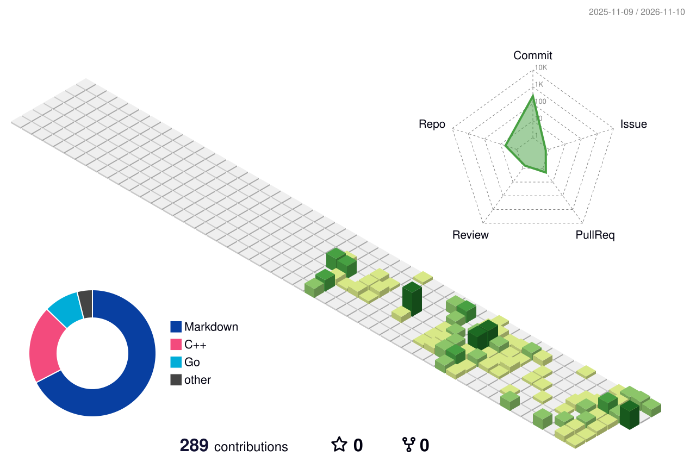

<div align="center">
  
</div>

# Hey, I'm Blair 👾

### Building things, one commit at a time.

**Go Backend · Distributed Systems**

</div>

---

## 🖥️ $ whoami

```bash
$ whoami
A developer exploring how systems work under the hood.

$ currently
Learning Go, Distributed Systems and Cloud Native.

$ philosophy
Understand the system, not just the API.
```

## ⚔️ Tech Arsenal

<p align="center">
  
</p>

## 🎮 Contribution Arcade

<p align="center">
  
</p>

<picture>
  <source
    media="(prefers-color-scheme: dark)"
    srcset="https://raw.githubusercontent.com/whitebrain0242/whitebrain0242/output-arcade/pacman-contribution-graph-dark.svg"
  />
  <source
    media="(prefers-color-scheme: light)"
    srcset="https://raw.githubusercontent.com/whitebrain0242/whitebrain0242/output-arcade/pacman-contribution-graph.svg"
  />
  
</picture>

## 🗺️ Engineering Journey

- **Go Backend:** Learning backend engineering and networking.
- **Distributed Systems:** Exploring distributed computing.
- **Cloud Native:** Exploring containers and infrastructure.

## 🚀 Featured Projects

<!-- Replace these with your real repositories -->

- [6.5840](https://github.com/whitebrain0242/6.5840) — MIT 6.5840

---

<div align="center">

**GAME NEVER OVER 👾**

Keep building. Keep exploring.

</div>

